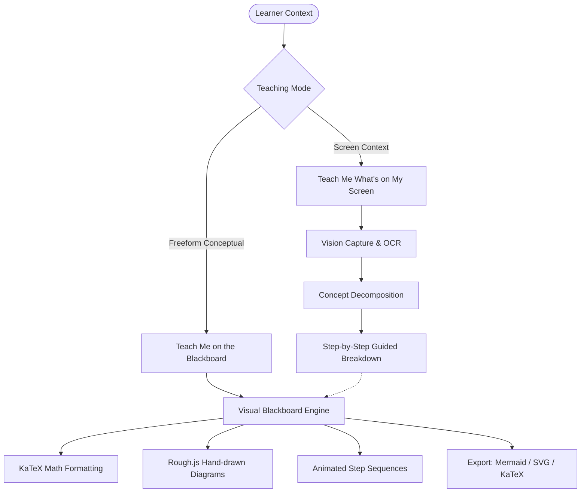

# Unfold — Product Specification

## 1. Executive Summary & Positioning
**Unfold** is an AI-powered interactive learning environment that transforms complex ideas into clear, visual, and contextual explanations. Traditional learning is fragmented across static textbooks, video lectures, chatbots, and diagramming tools. Unfold synthesizes these modalities into an integrated, dual-mode teaching canvas.

* **Category**: AI-Powered Interactive Learning Environment / Educational Workspace.
* **Core Brand Statement**: *"Understand anything. Learn everything."*
* **Supporting Proposition**: *"An AI learning environment that transforms complex ideas into clear, visual, interactive explanations."*
* **Core Distinction**: Unfold is **not** a conversational chatbot with text replies. It is an **active visual tutor** that grounds explanations directly in the learner's actual screen material and synthesizes mathematical equations, interactive diagrams, and progressive visual breakdowns on a dedicated teaching blackboard.

---

## 2. Target Audience & Personas

### Persona 1: The STEM & Engineering Student (Alex, 20)
* **Context**: Studying multivariable calculus, machine learning algorithms, and electrical circuits.
* **Pain Point**: Spends hours reading math proofs or dense code where static equations don't explain the underlying geometric intuition or state transitions. Switching between PDF viewers, ChatGPT, and Desmos causes cognitive overload.
* **Unfold Value**: Uses "Teach me what's on my screen" to highlight an equation or diagram directly from lecture slides; Unfold breaks it down step-by-step and animates the intuition on the Blackboard.

### Persona 2: The Self-Directed Developer & Technical Professional (Elena, 29)
* **Context**: Learning distributed systems, database internals, and systems architecture.
* **Pain Point**: Textual documentation leaves gaps in spatial and architectural understanding. Reading whitepapers feels disconnected from practical mental models.
* **Unfold Value**: Elena highlights paper diagrams or architecture schematics; Unfold extracts the components, generates an editable flowchart on the Blackboard, and provides interactive deep-dives on each node.

### Persona 3: The Visual & Conceptual Learner (Marcus, 17)
* **Context**: High school senior preparing for physics and biology exams.
* **Pain Point**: Gets bored and confused by wall-of-text explanations from standard AI chatbots.
* **Unfold Value**: Receives hand-drawn style visual sketches, KaTeX equations, and animated flow sequences that match how human teachers explain on physical chalkboards.

---

## 3. Core Product Capabilities & Modes

### A. Mode 1: "Teach me what's on my screen"
* **Context-Aware Visual Grounding**: Understands lecture slides, PDFs, code windows, research papers, and technical diagrams directly from screen captures or image uploads.
* **Optical Character & Formula Extraction**: Identifies mathematical notation, code syntax, and labeled diagrams.
* **Progressive Concept Slicing**: Rather than dumping a 500-word answer, the assistant dissects the material into foundational prerequisites, immediate mechanisms, and core takeaways.
* **Interactive Socratic Follow-ups**: Proactively tests the student's comprehension after each step with targeted micro-prompts.

### B. Mode 2: "Teach me on the blackboard"
* **Dedicated Visual Workspace**: A tactile, distraction-free digital blackboard.
* **Multi-Modal Rendering Pipeline**:
  * **Mathematical Proofs & Equations**: Rendered cleanly using KaTeX with color-coded syntax and highlighted terms.
  * **Structured Diagrams & Schematics**: Hand-drawn aesthetic using Rough.js style rendering to preserve the feeling of a personal tutor sketching live.
  * **Flowcharts & Architecture Trees**: Dagre/Mermaid layout generation for structural concepts.
  * **Interactive Steppers**: Step-by-step playback controls (Next step, Previous step, Play animation) that illustrate dynamic concepts over time.
* **Export & Sharing**: Native export to Mermaid syntax, SVG, PNG, and markdown notes.

---

## 4. User Journeys

### Journey 1: Public Discovery & Interactive Sample (Guest User)
1. **Landing (`/`)**: Visitor lands on the editorial-style marketing page, reads the headline, and sees interactive before-and-after comparisons between generic chatbots vs. Unfold's visual blackboard.
2. **Interactive Walkthrough (`/how-it-works`)**: Visitor experiences an interactive simulation showing how screen capture decomposes a neural network diagram into progressive steps.
3. **Curated Lessons (`/explore`)**: Visitor browses real-world sample lessons (e.g., Fourier Transform Intuition, Raft Consensus Protocol, Backpropagation) with full interactive blackboard visualizations—without needing an account.
4. **Conversion (`/signup`)**: Inspired by the sample experience, the visitor creates an account with email/password or OAuth.

### Journey 2: Deep Learning Session (Authenticated User)
1. **Dashboard (`/app`)**: Learner is greeted with recent learning sessions, mastery progress, and a clean prompt bar: *"What do you want to unfold today?"*
2. **Selection**: Learner chooses either **Upload / Screen Capture** or **New Blackboard Session**.
3. **Blackboard Interaction (`/app/board`)**: 
   * Learner enters: *"Explain gradient descent with momentum"*.
   * Unfold generates a visual blackboard containing: (1) The physical hill-analogy diagram, (2) The update equations with highlighted momentum terms $\beta$, and (3) An interactive slider showing ball oscillations.
4. **Saving & Organizing (`/app/library`)**: The lesson is automatically auto-saved with generated tags (`Calculus`, `Machine Learning`, `Optimization`) and added to the user's personal Library.

---

## 5. Success Metrics & Hackathon Criteria
* **Immediate Comprehension**: A visitor understands what Unfold does within 5 seconds of opening the landing page.
* **Visual Polish & Credibility**: Seamless editorial typography on public pages; deep, focused IDE/canvas aesthetic inside the web application. Zero "generic AI template" tropes.
* **Demonstrable Utility**: Fully functional sample lessons that interactive judges can manipulate immediately.
* **Architectural Integrity**: Clean separation of public vs. authenticated routes, proper security boundaries, and responsive desktop/tablet/mobile layouts.
