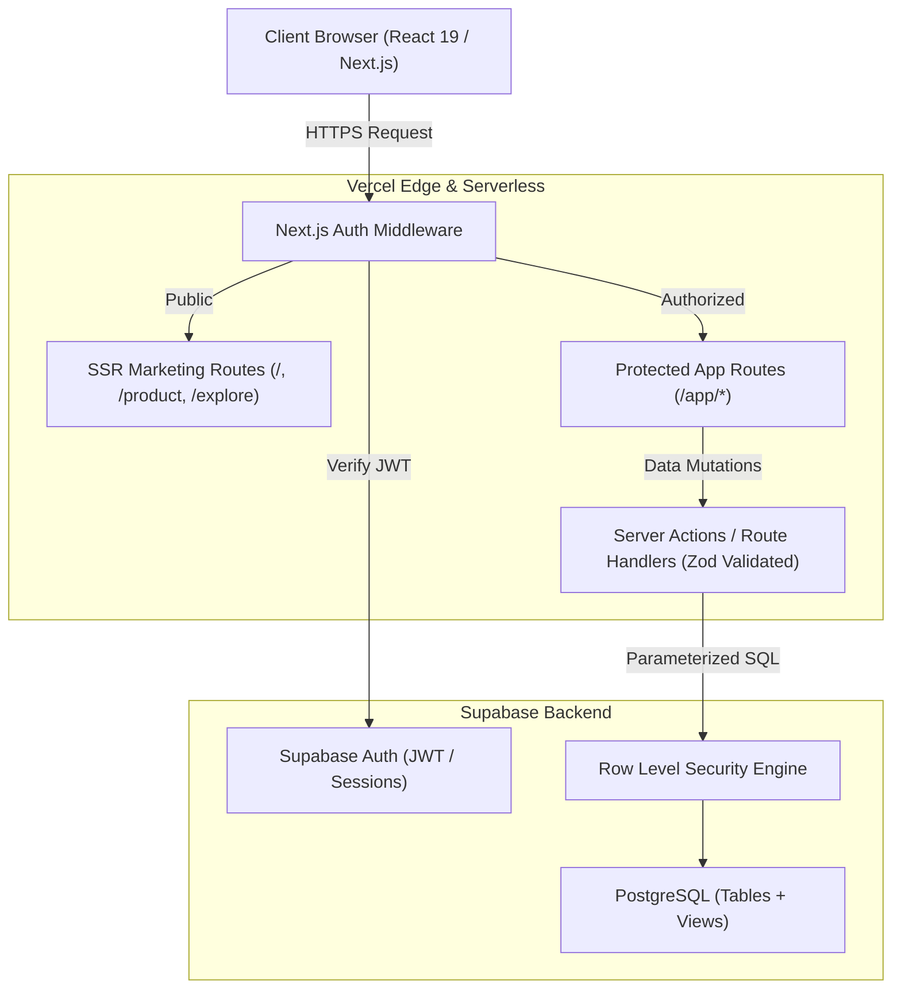

# Unfold — Technical Architecture & Specifications

## 1. System Overview & Technology Stack

The Unfold web application is designed as a secure, high-performance, full-stack Next.js application deployed on Vercel with Supabase providing authentication, PostgreSQL persistence, and Row Level Security (RLS).



### Core Technologies
* **Framework**: Next.js 15+ (App Router)
* **Frontend Runtime**: React 19, TypeScript (Strict Mode)
* **Styling**: Tailwind CSS, PostCSS, Lucide Icons, class-variance-authority (`cva`)
* **Mathematical & Visual Rendering**:
  * `KaTeX`: Server-side & client-side high-fidelity math formula rendering.
  * `Rough.js` / SVG: Chalk-style visual diagram synthesis.
  * `Framer Motion`: Fluid step-by-step blackboard timeline animations.
* **Authentication**: Supabase Auth (`@supabase/ssr` with PKCE cookie-based session management).
* **Database**: Supabase PostgreSQL with strict Row Level Security (RLS).
* **Validation**: Zod schema validation for all API routes and form submissions.
* **End-to-End Testing**: Playwright test suite for authentication flows and interactive blackboard state.

---

## 2. Database Schema & Data Models

### 1. `profiles` Table
Stores extended user profile information linked directly to `auth.users.id`.
```sql
create table public.profiles (
  id uuid references auth.users on delete cascade primary key,
  display_name text,
  avatar_url text,
  learning_goal text,
  created_at timestamp with time zone default timezone('utc'::text, now()) not null,
  updated_at timestamp with time zone default timezone('utc'::text, now()) not null
);

-- RLS
alter table public.profiles enable row level security;
create policy "Users can view own profile" on public.profiles for select using (auth.uid() = id);
create policy "Users can update own profile" on public.profiles for update using (auth.uid() = id);
```

### 2. `lessons` Table
Stores curated sample lessons (public) and user-created custom lessons.
```sql
create table public.lessons (
  id uuid default gen_random_uuid() primary key,
  creator_id uuid references auth.users(id) on delete set null,
  title text not null,
  slug text not null unique,
  subject text not null, -- 'Mathematics', 'Computer Science', 'Physics', etc.
  description text not null,
  is_public boolean default false not null,
  steps jsonb not null, -- Array of { stepNumber, title, explanation, mathBlocks, diagramData }
  created_at timestamp with time zone default timezone('utc'::text, now()) not null,
  updated_at timestamp with time zone default timezone('utc'::text, now()) not null
);

-- RLS
alter table public.lessons enable row level security;
create policy "Anyone can read public lessons" on public.lessons for select using (is_public = true);
create policy "Users can read own lessons" on public.lessons for select using (auth.uid() = creator_id);
create policy "Users can insert own lessons" on public.lessons for insert with check (auth.uid() = creator_id);
create policy "Users can update own lessons" on public.lessons for update using (auth.uid() = creator_id);
create policy "Users can delete own lessons" on public.lessons for delete using (auth.uid() = creator_id);
```

### 3. `saved_lessons` Table
Junction table for user bookmarks and personal library collections.
```sql
create table public.saved_lessons (
  id uuid default gen_random_uuid() primary key,
  user_id uuid references auth.users(id) on delete cascade not null,
  lesson_id uuid references public.lessons(id) on delete cascade not null,
  notes text,
  saved_at timestamp with time zone default timezone('utc'::text, now()) not null,
  unique (user_id, lesson_id)
);

-- RLS
alter table public.saved_lessons enable row level security;
create policy "Users can manage own saved lessons" on public.saved_lessons 
  for all using (auth.uid() = user_id) with check (auth.uid() = user_id);
```

### 4. `learning_progress` Table
Tracks progress, step completions, and comprehension checks.
```sql
create table public.learning_progress (
  id uuid default gen_random_uuid() primary key,
  user_id uuid references auth.users(id) on delete cascade not null,
  lesson_id uuid references public.lessons(id) on delete cascade not null,
  completed_step integer default 0 not null,
  is_completed boolean default false not null,
  last_accessed timestamp with time zone default timezone('utc'::text, now()) not null,
  unique (user_id, lesson_id)
);

-- RLS
alter table public.learning_progress enable row level security;
create policy "Users can view and update own progress" on public.learning_progress 
  for all using (auth.uid() = user_id) with check (auth.uid() = user_id);
```

### 5. `user_preferences` Table
Custom user workspace settings (blackboard theme, diagram roughness, animation speed).
```sql
create table public.user_preferences (
  user_id uuid references auth.users(id) on delete cascade primary key,
  blackboard_theme text default 'chalkboard-dark' not null,
  diagram_roughness numeric(3,2) default 1.50 not null,
  default_export_format text default 'mermaid' not null,
  motion_speed numeric(3,2) default 1.00 not null,
  updated_at timestamp with time zone default timezone('utc'::text, now()) not null
);

-- RLS
alter table public.user_preferences enable row level security;
create policy "Users can manage own preferences" on public.user_preferences 
  for all using (auth.uid() = user_id) with check (auth.uid() = user_id);
```

---

## 3. Authentication & Route Protection Architecture

### Cookie-Based PKCE Flow
1. Client calls `supabase.auth.signInWithPassword()` or OAuth provider.
2. `@supabase/ssr` creates HTTP-only, secure cookies on the response header.
3. Next.js `middleware.ts` runs on all requests to `/app/*`:
   * Validates the session token using `supabase.auth.getUser()`.
   * If invalid or expired, issues a clean redirect to `/login?redirect=[target]`.
   * Refreshes expired tokens automatically without interrupting user actions.
4. Server Components fetch data using the authenticated user context directly through RLS; unauthorized rows are filtered out at the database layer.

---

## 4. Security Architecture & Threat Model

* **Zero Service-Role Leakage**: The Supabase Service Role key is **never** bundled or exposed to frontend code. All mutations and queries use the user-scoped client governed by Postgres RLS.
* **Input Sanitization & Schema Validation**:
  * Every mutation endpoint and Server Action validates incoming payloads using `zod`.
  * Markdown and LaTeX formulas are sanitized against XSS using safe AST parsing (no raw `dangerouslySetInnerHTML` on untrusted user strings).
* **Content Security Policy (CSP)**: Strict headers configured in `next.config.mjs` prohibiting unauthorized inline script execution and unauthorized remote origins.
* **CORS & Rate Limiting**: Sensitive auth endpoints and API routes are rate-limited to mitigate credential stuffing and DoS attacks.

---

## 5. Deployment & CI/CD Pipeline

* **Hosting Target**: Vercel Serverless & Edge infrastructure.
* **Branch Isolation**:
  * `main`: Production deployment tied to production Supabase project.
  * Preview branches: Ephemeral preview deployments with isolated test data.
* **Verification Gates**:
  1. `npm run lint` & `tsc --noEmit`: Strict static type checking and ESLint rules.
  2. `npm run test`: Unit tests for lesson parsers and step state machines.
  3. `npx playwright test`: Full end-to-end smoke tests for auth and blackboard interactions.
  4. Production build: `next build` validation.
